<div align="center">

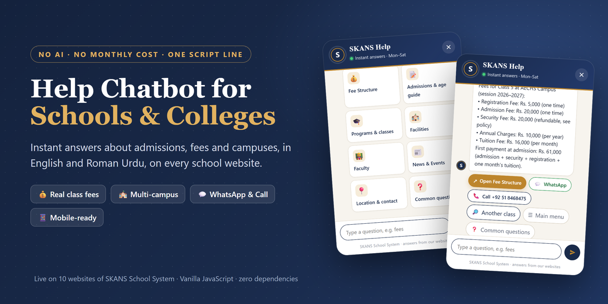

# 🎓 Help Chatbot for Schools & Colleges

**A fast, friendly help chat that answers parents' questions about admissions, fees and campuses, on every page of every school website.**
No AI. No API key. No database. No monthly bill. Add it with **one line of HTML**.

[](https://farooq831.github.io/Chatbot_for_School-College/)
[](docs/media/chatbot-demo.mp4)


</div>

---

## 📽️ See it in action

<div align="center">
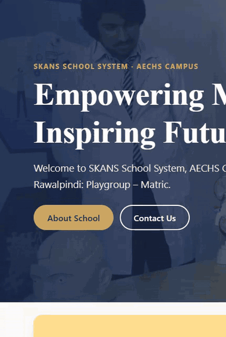

<sub>Recorded on the live AECHS Campus website. Full silent video (1:28): <a href="docs/media/chatbot-demo.mp4"><b>docs/media/chatbot-demo.mp4</b></a></sub>
</div>

In the video a parent:
1. sees the **"Hi there! 👋"** greeting and opens the chat,
2. browses the **Common questions** and opens *"Which documents are required?"*,
3. types **`5 class ki fee`** and gets the **real fee amounts** for Class 5, plus the first payment total,
4. types **`admision kaise`** (Roman Urdu, with a spelling mistake) and still gets the admission steps,
5. asks about another campus and is sent to **that campus's own website**,
6. on the **main website**, picks a campus from the list and opens its contact details, with **WhatsApp** and **Call** buttons.

---

## 💡 Why this chatbot?

Parents visiting a school website usually want the same few things: **fees, admission steps, required documents, age limits, timings, location and a phone number.** They don't want to dig through menus, and the office phone is busy during admission season.

This chatbot gives them those answers **in seconds, at any hour, on any device**, and always leaves a clear way to reach a real person.

| For parents | For the school |
|---|---|
| ⚡ Instant answers, 24/7, no waiting on the phone | 📞 Repeated questions about fees, documents and admissions are answered before anyone calls |
| 🗣️ Ask in **English or Roman Urdu**, typos are fine | 💸 **Zero running cost**: no AI subscription, no API key, no server |
| 💰 Exact fees for their child's class | 🧩 One shared chatbot for the main site **and every campus site** |
| 📍 One tap to the right page of the right campus | ✏️ Office staff edit answers in a simple text file, no developer needed |
| 💬 WhatsApp and Call buttons with every answer | 🛡️ Fixed, school-approved answers: it **can't make things up** |

> **Why no AI?** Schools need answers that are *correct*, not creative. A wrong fee or a made-up admission date costs trust. Here every answer is written and approved by the school, and the chat never invents anything. It also means no per-message cost and no parents' questions sent to a third-party AI.

---

## ✨ Features

### For visitors
- 👋 **Waving launcher and greeting**: a round school badge with a "Hi there!" bubble a few seconds after the page opens (once per visit).
- 🗂️ **Topic cards**: Fee Structure, Admissions & age guide, Programs & classes, Facilities, Faculty, News & Events, Location & contact.
- ❓ **Common questions**: a short list of the questions parents ask most, each with a ready answer.
- ⌨️ **Free-text search** with **500+ keywords** across **38 answers**, so parents can type the way they talk.
- 🇵🇰 **English + Roman Urdu**: `fees kitni hai`, `admission kaise`, `kagzat`, `umar`, `kab tak`…
- ✍️ **Typo-tolerant**: one wrong, missing or extra letter in longer words still matches (`admision`, `documants`, `fess`).
- 🤔 **"Did you mean…?"** with the top 3 matches when a question is unclear.
- 🙋 **Honest fallback**: if it doesn't know, it says so and offers WhatsApp, Call and popular questions.
- 😊 **Small talk**: hello / salam, how are you, who are you, thanks / shukriya, bye / Allah Hafiz.
- 💰 **Real fees per class**: `class 5 fee`, `5th class fees`, `kg fees`, `pre 9 fee`, `grade five fee`. It shows every fee line and the **first payment at admission** (admission + security + registration + one month's tuition).
- 💬 **Always a human next**: WhatsApp and Call buttons for the chosen campus under every answer.
- 📱 **Works on phone, tablet and desktop**, with a typing indicator for a natural feel.

### For multi-campus schools
- 🏫 **Main website**: the chat asks *"Which campus are you interested in?"* and remembers the choice on that device.
- 🎯 **Campus website**: the campus is detected automatically from the web address. The chat stays on that campus, and if someone asks about another campus it links to that campus's own website.
- 🔗 Every topic button opens **the chosen campus's own page**.
- 🧾 Answers can be **for all campuses, for one campus, main-site only, campus-site only, or different per campus**.
- 🔤 Placeholders `{campus}`, `{classes}`, `{phone}` are filled in automatically.

### For developers and admins
- 🪶 **Plain JavaScript and CSS**: no framework, no build step, no dependencies.
- 1️⃣ **One script tag** per website. Styles and data load automatically.
- 🛠️ **Data lives in two files** (`campuses.js`, `faq.js`), editable in cPanel File Manager.
- 🔄 **Updates reach every website within an hour**, without touching the websites.
- 🧯 **Fails safely**: if a data file has a mistake, the chat button just doesn't appear. The website never breaks.
- 🎨 Every class starts with `skc-` so it **never clashes** with the website's own CSS.
- ♿ **Accessible**: dialog role, `aria-live` messages, keyboard focus handling, `Esc` to close, respects *reduced motion*.
- 🔒 **Private by design**: no cookies, no tracking, no personal data collected. It only remembers the chosen campus in the visitor's browser.

---

## 🖼️ Screenshots

<table>
<tr>
<td colspan="3">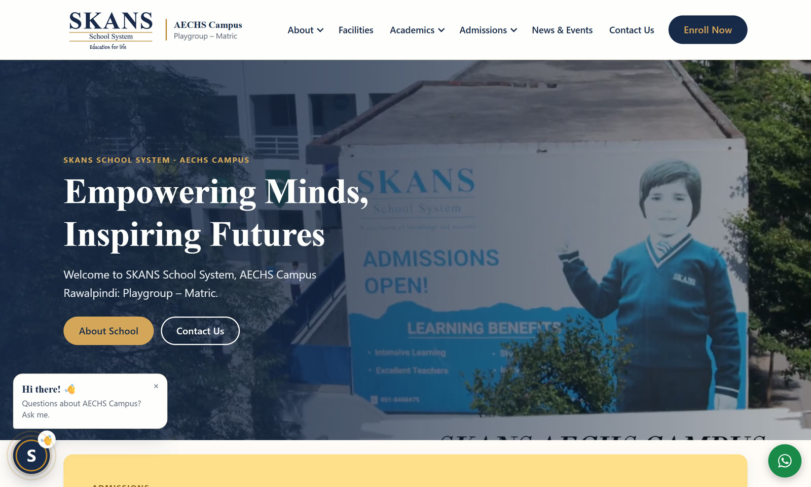<br><sub><b>On a campus website:</b> waving launcher (bottom-left, so it never covers the WhatsApp button) and greeting</sub></td>
</tr>
<tr>
<td width="33%">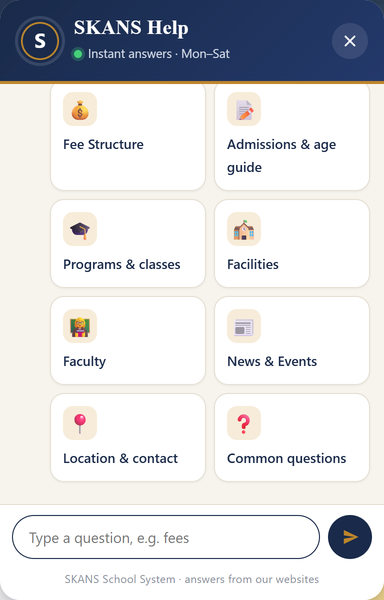<br><sub><b>Topic cards</b> for the detected campus</sub></td>
<td width="33%">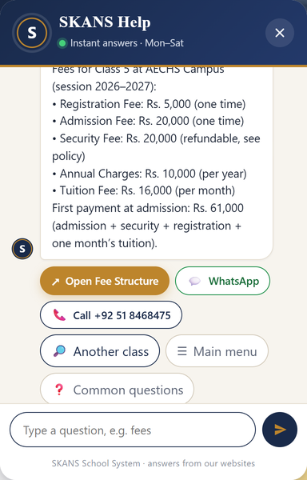<br><sub><b>Real fees</b> for "5 class ki fee", with the first payment total</sub></td>
<td width="33%">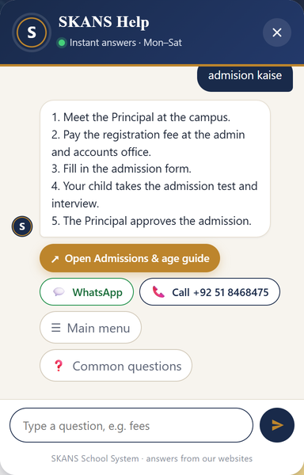<br><sub><b>Roman Urdu + typo:</b> "admision kaise"</sub></td>
</tr>
<tr>
<td>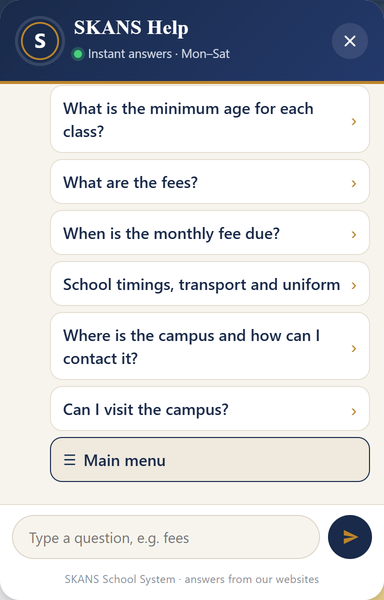<br><sub><b>Common questions</b> parents ask most</sub></td>
<td>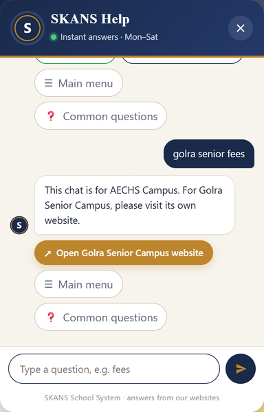<br><sub>On a campus site it <b>stays on its campus</b> and links to the other one</sub></td>
<td>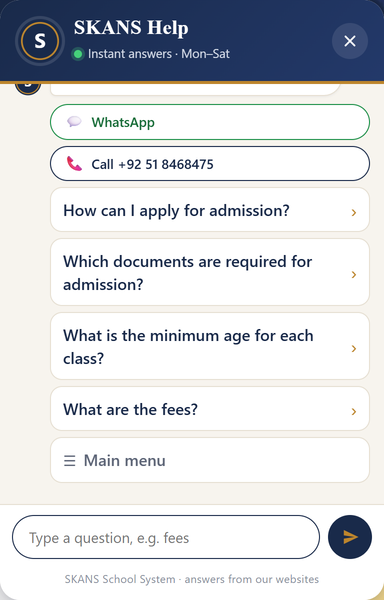<br><sub><b>Honest fallback:</b> WhatsApp, Call and popular questions</sub></td>
</tr>
<tr>
<td colspan="3">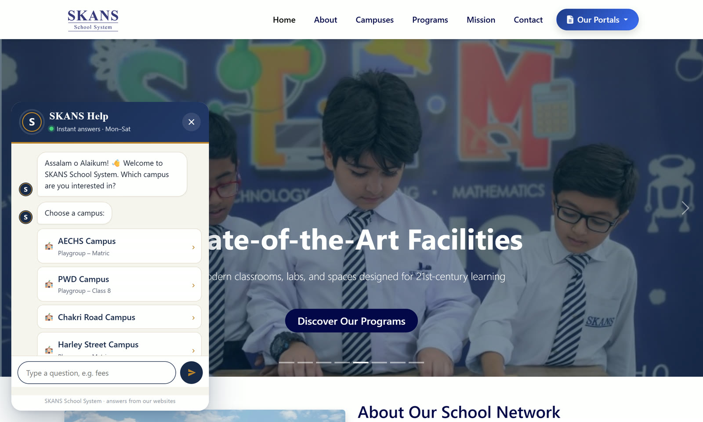<br><sub><b>On the main website:</b> the chat asks which campus first</sub></td>
</tr>
<tr>
<td>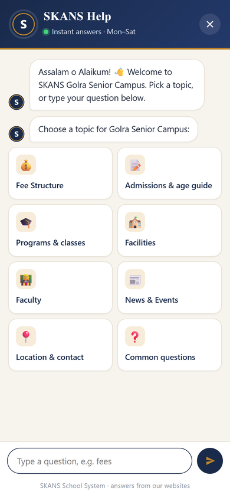<br><sub><b>Mobile:</b> full-screen chat</sub></td>
<td>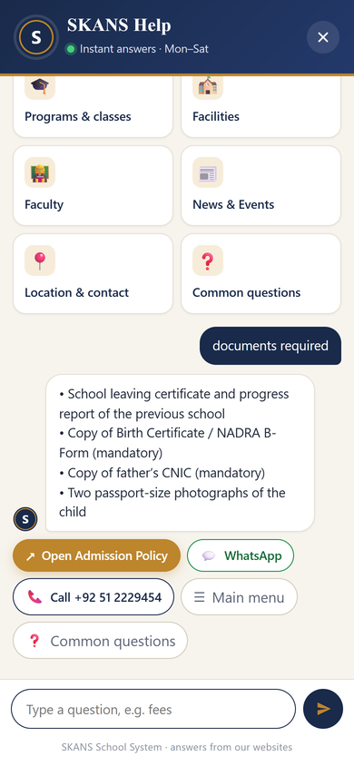<br><sub><b>Mobile:</b> required documents</sub></td>
<td>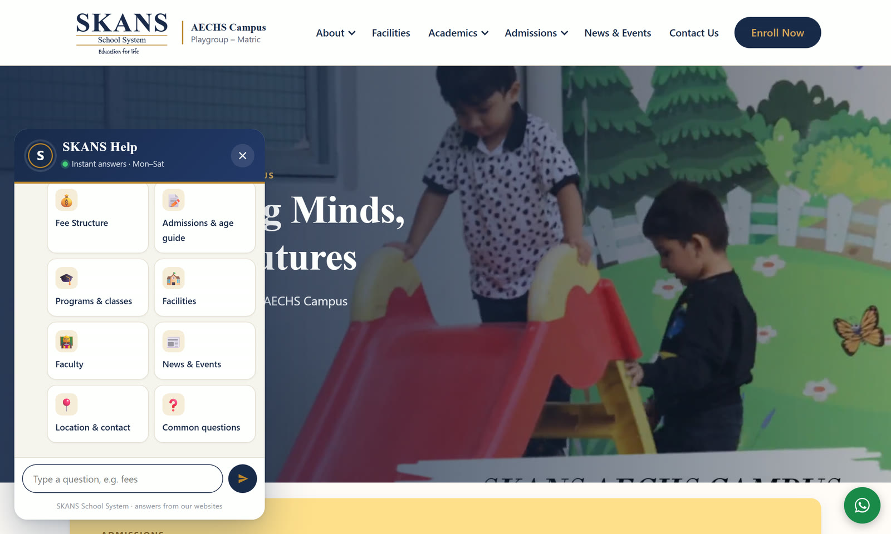<br><sub>The chat open over a real campus homepage</sub></td>
</tr>
</table>

---

## ⚙️ How it works

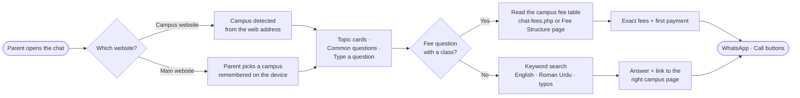

**Matching, in short:** the question is lower-cased and split into words. Each answer gets points for every keyword it contains (multi-word phrases count more), plus a point for a near-match with one letter wrong. A clear winner is answered directly. Close scores get a *"Did you mean"* list. No match gives the honest fallback.

---

## 🚀 Quick start

### 1. Upload the folder
Upload the [`chatbot/`](chatbot/) folder to your main website, e.g. `public_html/chatbot/`.

### 2. Add one line before `</body>` on every website
```html
<script src="https://your-school.edu/chatbot/chatbot.js?v=3" defer></script>
```
That's it. The script loads its own `chatbot.css`, `campuses.js` and `faq.js` from the same folder.

### 3. Optional attributes

| Attribute | Example | What it does |
|---|---|---|
| `data-campus` | `data-campus="golra"` | Force a campus (normally detected from the web address) |
| `data-position` | `data-position="right"` | Put the button bottom-right (default: left, to keep clear of WhatsApp buttons) |
| `data-container` | `data-container="#chat"` | Show the chat inside an element instead of the page corner |
| `data-open` | `data-open="true"` | Open the chat when the page loads (good for demo pages) |

### Try it locally
```bash
git clone https://github.com/farooq831/Chatbot_for_School-College.git
cd Chatbot_for_School-College
python -m http.server 8000
# open http://localhost:8000/            (demo page with campus switcher)
# or   http://localhost:8000/chatbot/demo.html?campus=aechs
```

---

## 🛠️ Make it yours

### Campuses: [`chatbot/campuses.js`](chatbot/campuses.js)
```js
window.SKANS_CHAT_CAMPUSES = [
  { "id": "aechs", "name": "AECHS Campus", "url": "https://aechscampus.skansschool.edu.pk/",
    "classes": "Playgroup – Matric", "phone": "+92 51 8468475", "tel": "+92518468475",
    "whatsapp": "923335352965" }
];
```

| Field | Meaning |
|---|---|
| `id` | Short lowercase name (don't change it once used) |
| `name` | Shown on buttons |
| `url` | Campus website, ending with `/`. **Used to detect the campus automatically** |
| `classes` | Small line under the name, e.g. `Playgroup – Class 5` |
| `phone` / `tel` | Shown on the Call button / digits used to dial |
| `whatsapp` | Digits with country code, for the WhatsApp button |
| `pages` | *(optional)* custom page file per topic, for sites with different page names |

A single-campus school or college just lists **one** campus.

### Questions and answers: [`chatbot/faq.js`](chatbot/faq.js)
```js
{ "q": "Which documents are required for admission?", "show": true,
  "a": "• Birth Certificate / B-Form\n• Father's CNIC\n• Two photographs",
  "keywords": ["documents", "papers", "b-form", "cnic", "kagzat"],
  "campus": "all", "topic": "policy" }
```

| Field | Meaning |
|---|---|
| `q` | The question (shown as a button) |
| `a` | The answer. `\n` = new line. `{campus}` `{classes}` `{phone}` are filled in |
| `keywords` | Words parents may type: English **and** Roman Urdu, lowercase |
| `show` | `true` = listed under **Common questions** (keep about 8). Others are found by typing |
| `campus` | `"all"` or one campus `id` |
| `only` | `"main"` = main website only · `"campus"` = campus websites only |
| `per` | A different answer per campus: `{ "golrasr": "…", "*": "everyone else" }` |
| `topic` | Adds a button to that campus page: `fees`, `admissions`, `policy`, `programs`, `special`, `facilities`, `faculty`, `news`, `about`, `contact`, `policies` |
| `link` / `linkText` | A button to any address instead of a topic (e.g. `mailto:`) |
| `feeTable` | `true` = after the answer, show class buttons with real fees |

**Small talk** lives at the bottom of `faq.js` in `SKANS_CHAT_SMALLTALK`. Each reply has a `pre` line for messages like *"hello, what are the fees?"*.

> ✅ **Rule of thumb:** only write facts the school has confirmed. If something differs by campus (timings, transport, uniform), let the answer send parents to the campus office.

---

## 💰 Real fees in the chat

When a parent types a fee question that names a class, the chat finds the campus fee table in this order:

1. **`chat-fees.php`** on the campus website (JSON), if present. An example is in [`server/chat-fees.php`](server/chat-fees.php).
2. Otherwise it **reads the table on the campus Fee Structure page** (`<table class="sk-table">`), so the chat always matches what the page shows.
3. If neither can be read, it shows the **Fee Structure** link. Never an error.

<details>
<summary><b>JSON format of chat-fees.php</b></summary>

```json
{
  "campus": "Demo Campus",
  "session": "2026–2027",
  "currency": "Rs.",
  "columns": [
    { "key": "registration", "label": "Registration Fee", "period": "one time" },
    { "key": "admission",    "label": "Admission Fee",    "period": "one time" },
    { "key": "security",     "label": "Security Fee",     "period": "refundable" },
    { "key": "tuition",      "label": "Tuition Fee",      "period": "per month" }
  ],
  "classes": [
    { "class": "Class 5", "registration": 5000, "admission": 18000, "security": 12000, "tuition": 14500 }
  ]
}
```
It understands class names like `Playgroup`/`pg`, `Nursery`, `Kindergarten`/`kg`/`prep`, `Pre 9`, `O Level`, `A Level`, `Class 5`/`5th`/`grade five`/`5 class ki`. The main website can show amounts too, because the endpoint sends `Access-Control-Allow-Origin: *` (fees are public information).
</details>

---

## 📁 Project structure

```
Chatbot_for_School-College/
├── chatbot/
│   ├── chatbot.js      # the chat engine and window (no need to edit)
│   ├── chatbot.css     # the look: navy + gold theme, all classes prefixed skc-
│   ├── campuses.js     # campuses: name, website, classes, phone, WhatsApp   ← edit
│   ├── faq.js          # questions, answers, keywords, small talk            ← edit
│   ├── demo.html       # quick test page (?campus=<id> acts like a campus site)
│   └── .htaccess       # browsers pick up chatbot updates at once
├── server/
│   └── chat-fees.php   # example JSON fee endpoint for a campus website
├── docs/
│   ├── SETUP-CPANEL.md # step-by-step guide for office/admin staff
│   ├── screenshots/
│   └── media/          # demo video (MP4, no audio) and GIF
└── index.html          # live demo page (GitHub Pages)
```

---

## 🌐 Deployment notes

- **Caching:** `chatbot/.htaccess` tells browsers to re-check chatbot files on every visit (a quick "not changed" answer), so updates show at once. `campuses.js` and `faq.js` also carry an hourly version number, so **edits reach every website within an hour** even without the `.htaccess`.
- **Version bump:** after replacing `chatbot.js` or `chatbot.css`, change `?v=3` to `?v=4` in the script tag only if a site still shows the old version.
- **Safe failures:** missing data = no button, a failed fee lookup = a link, a blocked network = the normal answer. The host page is never affected.
- **Browsers:** modern browsers on desktop and mobile. On phones the chat opens full screen.

Non-technical setup steps for office staff are in [`docs/SETUP-CPANEL.md`](docs/SETUP-CPANEL.md).

---

## 🏫 In production

This chatbot runs on the **main website and all 9 campus websites of SKANS School System** (Rawalpindi / Islamabad, Pakistan): AECHS, PWD, Chakri Road, Harley Street, Golra Junior, Golra Senior, Westridge Senior, Westridge Junior and Westridge EYE.
One shared folder on the main website serves all **10 websites**.

## 🎯 Good fit for

- 🏫 **Schools** with one or many campuses
- 🎓 **Colleges, academies and coaching centres** answering admission and fee questions
- 🏛️ Any organisation that wants a **reliable, zero-cost FAQ chat** instead of an unpredictable AI bot

---

## 👤 Author

Built by **[@farooq831](https://github.com/farooq831)** for SKANS School System.

If this project helps your school, please ⭐ **star the repo**. Questions and suggestions are welcome in [Issues](https://github.com/farooq831/Chatbot_for_School-College/issues).
